<!-- header:start -->
<div align="center">


<a href="#-quick-start"></a>

<a href="LICENSE"></a>

<a href="https://github.com/ajendras/dorking-scout/stargazers"></a>
<a href="https://github.com/ajendras/dorking-scout/actions/workflows/ci.yml"></a>

<a href="CONTRIBUTING.md"></a>

**Discover unique websites by tech stack, payment gateway or product niche using curated search dorks**

[✨ Features](#-features) • [⚡ Quick start](#-quick-start) • [🧰 Usage](#-usage) • [🧩 Architecture](#-architecture) • [📍 Roadmap](#-roadmap) • [🤝 Contributing](#-contributing)

</div>
<!-- header:end -->

## ✨ Why Dork Scout?

Security researchers, OSINT practitioners and market analysts need to surface real-world sites using specific payment gateways, platforms or selling products in a narrow vertical. Paid tools like BuiltWith are expensive while public dork lists are fragmented, outdated and full of noise. Dork Scout delivers a free, curated, instantly usable catalog of high-signal dorks with a warm organic UI, multi-engine search, automatic deduplication and lightweight fingerprinting.

- Hundreds of tested dorks grouped into **payment gateways**, **platforms** and **product niches**
- Safe, rate-limited queries across Google, Bing, DuckDuckGo, Baidu and Yandex
- API-less tech detection inspired by Wappalyzer using HTML signatures and headers
- Domain age (Wayback Machine CDX) and SSL certificate metadata (crt.sh CT logs) enrichment on results
- One-click CSV/JSON export of clean, deduplicated domains with metadata
- ⏰ **Scheduled background jobs** that watch for fresh domains and deliver email or webhook alerts

## 🎬 Demo

<p align="center"></p>

## 🚀 Features

<table>
<tr>
<td width="33%">
💳 <b>Curated Dorks</b><br>
Hundreds of tested patterns for gateways, CMS platforms and niches
</td>
<td width="33%">
🔎 <b>Multi-Engine</b><br>
Queries Google, Bing, DuckDuckGo, Baidu and Yandex with built-in rate-limit safety
</td>
<td width="33%">
📦 <b>Niche Explorer</b><br>
Find stores selling shoes, books, egifts or any custom vertical
</td>
</tr>
<tr>
<td>
🔬 <b>API-less Scan</b><br>
Lightweight fingerprinting via regex signatures on HTML and headers
</td>
<td>
🧹 <b>Deduplication</b><br>
Removes marketplaces and noise, returns unique second-level domains
</td>
<td>
📤 <b>One-click Export</b><br>
Download results with metadata as CSV or JSON
</td>
</tr>
<tr>
<td>
🖼️ <b>Category Browser</b><br>
Beautiful blob-shaped cards and filters using the sand/olive palette
</td>
<td>
⚡ <b>Async Runner</b><br>
Background workers keep the HTMX UI responsive during scans
</td>
<td>
📋 <b>Rich Results</b><br>
<code>DiscoveryResult</code> objects combine domains, detected tech and timestamps
</td>
</tr>
<tr>
<td>
💾 <b>Persistence</b><br>
SQLite store records every search and accumulates unique domains with history
</td>
<td>
🌐 <b>Metadata Enrichment</b><br>
Domain age from Wayback Machine CDX API and SSL cert details from crt.sh (free, no keys)
</td>
<td>
🤖 <b>LLM Dork Gen</b><br>
Local LLM (Ollama) helper generates high-quality dorks for unknown or new tech
</td>
</tr>
<tr>
<td colspan="3">
🧩 <b>Browser Extension</b><br>
Companion Chrome extension that detects technologies on the current page (Wappalyzer-style signatures) and offers one-click dork suggestions that open Google with the exact curated pattern
</td>
</tr>
<tr>
<td colspan="3">
⏰ <b>Scheduled Alerts</b><br>
Persistent background jobs (APScheduler) that run curated searches on an interval, detect brand-new domains and deliver rich alerts via email (smtplib) or webhook (JSON payload)
</td>
</tr>
</table>

## 🗄️ Persistent Storage

Every search automatically saves to a local SQLite database (`dorkscout.db`). 

- Unique domains accumulated over time with `first_seen`/`last_seen`, `seen_count` and detected tech
- Full history of queries, categories, terms and result counts
- **New**: `scheduled_jobs` table storing monitoring jobs with alert configuration, `last_run` and `last_alerted` timestamps
- New API endpoints `/api/history`, `/api/domains` and `/api/schedules` for querying and managing activity

This enables deduplication across sessions, future analytics and scheduled alerts.

## 📦 Installation

Requires Python 3.9+ and no external services.

```bash
git clone https://github.com/ajendras/dorking-scout.git
cd dorking-scout
pip install -e .
```

Start the server:

```bash
dork-scout
```

The app will be available at http://127.0.0.1:8000 with the warm organic UI (soft paper texture, serif headings, terracotta/olive accents). The `AlertScheduler` starts automatically on boot.

## ⚡ Quick start

```python
import asyncio
from dorkscout.dorks import get_dorks, build_query
from dorkscout.search import SearchClient
from dorkscout.detector import detect_technologies, enrich_discovery_results
from dorkscout.models import DiscoveryResult

async def main():
    # Find Shopify stores in the coffee niche
    patterns = get_dorks(tech="Shopify")
    client = SearchClient(timeout=10.0)
    
    query = build_query(patterns[0], "coffee")
    # query now automatically quotes the term for precision:
    # e.g. '"powered by shopify" OR ".myshopify.com" "coffee"'
    domains = await client.search_with_rate_limit(query, patterns[0].engine)
    
    print("Discovered domains:", domains[:5])
    
    # Lightweight detection + enrichment on first handful of results
    results: list[DiscoveryResult] = []
    for domain in domains[:3]:
        html = ""  # would be fetched in real usage
        tech = detect_technologies(html)
        result = DiscoveryResult(
            domain=domain,
            tech=tech or ["Shopify"],
            url=f"https://{domain}",
            detected_at="2024-12-18T10:00:00Z",
        )
        results.append(result)
    
    await enrich_discovery_results(results)
    for r in results:
        print(
            f"{r.domain} — age: {r.domain_age_days} days, "
            f"issuer: {r.ssl_issuer}, valid until: {r.ssl_valid_to}"
        )
    
    await client.close()

asyncio.run(main())
```

The server can also be started with `dork-scout` and used via the browser or `/api/search`.

## 🧰 Usage

### Explore payment gateways

```bash
python examples/discover_payments.py
```

This script uses `get_dorks(tech="Stripe")`, appends a gift-card term via `build_query()` (which now consistently quotes the supplied term as a phrase), runs searches through `SearchClient.search_with_rate_limit()`, applies `detect_technologies()`, enriches results with `enrich_discovery_results()` (domain age + SSL metadata) and writes a CSV using `DiscoveryResult` objects. New columns for `domain_age_days`, `ssl_issuer`, etc. are included.

### Niche product search

```bash
python examples/niche_books.py
```

Demonstrates the “niches” category with product-specific terms, deduplication against the `noise_domains` set, enrichment via free sources, and export of up to 20 unique domains.

### Generating dorks for unknown tech (new)

Requires [Ollama](https://ollama.com) installed and running locally (`ollama serve`) with a model pulled (recommended: `ollama pull llama3.2`).

```python
import asyncio
from dorkscout.dorks import generate_dorks_for_tech
from dorkscout.models import DorkPattern

async def main():
    # Generate fresh dorks for a technology not in the built-in database
    patterns: list[DorkPattern] = await generate_dorks_for_tech(
        tech_name="NewCMS",
        category="platforms",
        num_dorks=4
    )
    for p in patterns:
        print(p)
        # Example output: G:"inurl:newcms admin" OR "powered by newcms" ...

    # The patterns can be copied into dorks.json under a "NewCMS" key
    # and a tech_to_category entry to make them permanent.

asyncio.run(main())
```

The helper calls the local Ollama instance with a carefully crafted prompt, parses the JSON response, validates each pattern with Pydantic and falls back to a generic keyword dork if the LLM is unavailable.

### Scheduled background jobs with alerts (new)

The `AlertScheduler` (started automatically by the FastAPI app) runs persistent monitoring jobs on a configurable interval. Each job executes a curated dork search, identifies **fresh** domains (never seen before in the SQLite store), enriches them with metadata, records them, and fires an alert.

**Add a job via the API**

```bash
curl -X POST http://127.0.0.1:8000/api/schedules \
  -H "Content-Type: application/json" \
  -d '{
    "name": "New Stripe coffee shops",
    "tech": "Stripe",
    "term": "coffee",
    "interval_hours": 6,
    "alert": {
      "alert_type": "webhook",
      "target": "https://your-webhook.endpoint/alert"
    }
  }'
```

List jobs:

```bash
curl http://127.0.0.1:8000/api/schedules
```

Delete a job:

```bash
curl -X DELETE http://127.0.0.1:8000/api/schedules/xxxxxxxx-xxxx-xxxx-xxxx-xxxxxxxxxxxx
```

**Email alerts**

Edit `ALERT_CONFIG["smtp"]` in `src/dorkscout/config.py` with your SMTP credentials (TLS supported). Then use `"alert_type": "email", "target": "you@example.com"`. The payload includes the list of fresh domains plus enriched `DiscoveryResult` data.

The scheduler respects the same rate limits and deduplication logic as interactive searches. Freshness is determined by absence from the `domains` table; `last_alerted` is updated after a successful alert.

### API-driven search

```bash
curl -X POST http://127.0.0.1:8000/api/search \
  -H "Content-Type: application/json" \
  -d '{"category":"niches","term":"vintage leather"}'
```

Returns a JSON payload with `results`, `total`, `queries_used` and rich `DiscoveryResult` entries (including the new enrichment fields).

### Generating dorks via API (new)

```bash
curl -X POST http://127.0.0.1:8000/api/generate_dorks \
  -H "Content-Type: application/json" \
  -d '{"tech":"AcmePayments","category":"payment_gateways","num_dorks":3}'
```

Returns suggested `DorkPattern` objects that can be added to `dorks.json`.

### Querying search history

```bash
curl "http://127.0.0.1:8000/api/history?limit=10"
```

Returns recent searches, result counts and total unique domains persisted in the SQLite store. The `DiscoveryStore` is automatically initialised on app startup and persists across runs.

### Browser Extension

A companion Chrome/Edge extension lives in the `extension/` directory. It performs lightweight technology detection on the current page using the same regex signatures as the Python backend (inspired by Wappalyzer). Detected technologies that match the curated dork database are presented with one-click buttons that open Google using the exact high-signal dork.

**Installation**

1. Open `chrome://extensions/` (or `edge://extensions/`)
2. Enable **Developer mode**
3. Click **Load unpacked** and select the `extension` folder
4. Visit any site using a known technology (Shopify, Stripe, WooCommerce, etc.)
5. Click the Dork Scout icon in the toolbar

The extension works completely offline with a bundled copy of signatures and dorks; it will also attempt to call the local Dork Scout API (`/api/dorks`) when the server is running for the freshest patterns.

<details><summary>Exporting results programmatically</summary>

```python
import httpx
resp = httpx.get(
    "http://127.0.0.1:8000/api/export",
    params={"tech": "Stripe", "term": "gift", "format": "csv"}
)
with open("stripe_gift.csv", "wb") as f:
    f.write(resp.content)
```
The endpoint uses the same `get_dorks()` + `SearchClient` flow but limits detection for speed, applies enrichment on a few results, and streams CSV with semicolon-separated tech lists plus the new metadata columns.

</details>

<details><summary>Extending the dork database</summary>

Community PRs can extend the dork database by placing a `dorks.json` in the project root (or editing `DEFAULT_DORK_DB` in `config.py`). The loader now performs a **deep merge** (new techs/patterns are added; duplicate signatures are skipped) and the database is automatically validated on import by `validate_dork_database()`.

The new `generate_dorks_for_tech()` helper can be used to bootstrap high-quality patterns for technologies that are not yet covered. Validation enforces:
- Pydantic models for every `Category` and `DorkPattern`
- Valid engines (google|bing|duckduckgo|baidu|yandex)
- Consistent `tech_to_category` mapping
- Non-empty patterns and known categories

See `tests/test_dorks.py` for the validation test suite. New contributions must pass these checks (and the existing test suite). `get_tech_to_category()` and `get_dorks()` automatically pick up extensions. The `build_query()` helper now always quotes additional terms (single- or multi-word) unless already quoted.

</details>

## 🔧 Configuration

<table>
<tr><th>Option</th><th>Default</th><th>Description</th></tr>
<tr><td><code>DORKS_JSON_PATH</code></td><td><code>./dorks.json</code></td><td>Optional file that extends or overrides <code>DEFAULT_DORK_DB</code> (loaded by <code>config.py</code> with deep merge)</td></tr>
<tr><td><code>SEARCH_ENGINES</code></td><td>Google, Bing, DuckDuckGo, Baidu, Yandex</td><td>List of dicts with <code>base</code>, <code>query_param</code> and <code>rate_limit</code> used by <code>SearchClient</code> (full scraping support for all engines)</td></tr>
<tr><td><code>OLLAMA_URL</code></td><td><code>http://localhost:11434/api/generate</code></td><td>Local Ollama endpoint used by the LLM dork generator (configurable in <code>config.py</code>)</td></tr>
<tr><td><code>DEFAULT_LLM_MODEL</code></td><td><code>llama3.2</code></td><td>Model used by <code>generate_dorks_for_tech()</code>. Must be pulled locally with Ollama.</td></tr>
<tr><td><code>ALERT_CONFIG</code></td><td>SMTP + webhook defaults</td><td>SMTP host/port/credentials (for email alerts) and webhook headers. Edit directly in <code>config.py</code>. Cooldown and TLS settings included.</td></tr>
<tr><td><code>validate_dork_database()</code></td><td>runs on import</td><td>Pydantic + custom checks for dorks, categories and mappings. Enables safe community extensions (see tests).</td></tr>
<tr><td><code>TECH_TO_CATEGORY</code></td><td>Now part of DB (extensible)</td><td>Links tech names to categories; new techs require a mapping entry in <code>dorks.json</code></td></tr>
<tr><td><code>timeout</code> (SearchClient)</td><td>12.0</td><td>httpx timeout passed to <code>AsyncClient</code></td></tr>
<tr><td><code>DB_PATH</code></td><td><code>./dorkscout.db</code></td><td>SQLite file for persistent domain and search history (auto-created and managed by <code>DiscoveryStore</code>). Now also stores <code>scheduled_jobs</code>.</td></tr>
<tr><td><code>build_query()</code></td><td>—</td><td>Now consistently quotes the supplied <code>term</code> as a phrase for improved precision on both single-word and multi-word inputs (updated in v0.1.0 CI fixes).</td></tr>
<tr><td><code>enrich_discovery_results()</code></td><td>—</td><td>Async helper (limited to first 6 results) that calls free public APIs (Wayback Machine CDX + crt.sh). Internal semaphore and timeouts keep usage respectful.</td></tr>
</table>

## 🧩 Architecture

```mermaid
flowchart TD
    UI[Browser + HTMX] --> Web[web.py routes<br/>index, category_page]
    Web --> API[api.py router<br/>/api/search, /api/export, /api/history, /api/generate_dorks, /api/dorks, /api/schedules]
    API --> Dorks[dorks.py<br/>get_dorks() • build_query() • generate_dorks_for_tech()]
    Dorks --> Config[config.py<br/>DORK_DB + SEARCH_ENGINES + OLLAMA_CONFIG + ALERT_CONFIG + DB_PATH]
    API --> Search[search.py<br/>SearchClient.search_with_rate_limit() (Google/Bing/DDG/Baidu/Yandex)]
    Search --> Parser[parse_results() +<br/>BeautifulSoup]
    Parser --> Detector[detector.py<br/>detect_technologies() + enrich_discovery_results()<br/>using free APIs (Wayback + crt.sh)]
    Detector --> Models[models.py<br/>DiscoveryResult + SearchHistory + StoredDomain + ScheduledJob + AlertConfig]
    API --> Store[store.py<br/>DiscoveryStore + SQLite (searches, domains, scheduled_jobs)]
    Store --> DB[(dorkscout.db)]
    Scheduler[scheduler.py<br/>AlertScheduler (APScheduler)] --> Store
    Scheduler --> Search
    Scheduler --> Detector
    Scheduler --> Alerts[send_alert() — smtplib email or async webhook]
    API --> Export[CSV/JSON StreamingResponse]
    LLM[Local Ollama] --> Dorks
    EXT[Browser Extension<br/>(extension/)] --> DETECT[Content script<br/>Wappalyzer-style detection]
    EXT --> POPUP[Popup UI<br/>shows detected tech + one-click Google dorks]
    POPUP --> API
```

The codebase separates concerns cleanly: `dorks.py` and `config.py` manage the curated database, `search.py` handles async multi-engine queries with noise filtering, `detector.py` adds technology fingerprints plus domain/SSL enrichment from free sources, `store.py` provides persistent history (now including scheduled jobs), `scheduler.py` runs background monitoring with APScheduler, and FastAPI routers (`api.py`, `web.py`) serve both the organic UI and JSON endpoints. All heavy lifting runs in background workers so the HTMX interface stays responsive. The new local-LLM helper lives in `dorks.py` and talks directly to Ollama's REST API. The companion browser extension brings the same detection logic to the browser and surfaces curated dorks instantly. Email alerts use the Python standard library; webhooks are sent asynchronously.

## 📁 Project structure

```text
.
├── pyproject.toml                 # Metadata, dependencies, console_scripts entry 'dork-scout'
├── dorks.json                     # Optional override (merged with DEFAULT_DORK_DB)
├── extension/                     # Companion browser extension (Manifest V3)
│   ├── manifest.json
│   ├── popup.html
│   ├── popup.js
│   └── content.js
├── src/dorkscout/
│   ├── main.py                    # create_app() FastAPI factory + run() uvicorn entrypoint (now starts AlertScheduler)
│   ├── config.py                  # DEFAULT_DORK_DB, SEARCH_ENGINES, OLLAMA_CONFIG, ALERT_CONFIG, DB_PATH, load functions
│   ├── models.py                  # Category, DorkPattern, DiscoveryResult, SearchHistory, StoredDomain, ScheduledJob, AlertConfig
│   ├── dorks.py                   # load_dorks, get_dorks, build_query, list_all_techs + generate_dorks_for_tech
│   ├── search.py                  # SearchClient (async Google/Bing/DDG/Baidu/Yandex) + parse_results
│   ├── detector.py                # detect_technologies + TECH_SIGNATURES + async enrichment
│   ├── store.py                   # Persistent SQLite layer (DiscoveryStore) — now includes scheduled_jobs
│   ├── scheduler.py               # AlertScheduler, APScheduler integration, freshness detection + email/webhook delivery (new)
│   ├── api.py                     # /api/categories, /api/search (POST), /api/export, /api/history, /api/generate_dorks, /api/dorks, /api/schedules
│   └── web.py                     # UI routes serving Jinja2 templates with HTMX
├── examples/
│   ├── discover_payments.py       # Stripe + gift-card example with CSV export
│   └── niche_books.py             # Product-niche demo exporting unique domains
├── tests/
│   ├── test_dorks.py              # Tests for loading, filtering, query building, validation and LLM helper
│   └── test_search.py             # Mocked HTML parsing, deduplication, enrichment and store tests
└── templates/index.html           # Earthy UI with blob cards, Tailwind + HTMX
```

## 🧪 Testing

```bash
pytest
```

The suite (`tests/test_dorks.py` and `tests/test_search.py`) covers `load_dorks()`, category/tech filtering, `build_query()` term handling (including automatic quoting), `parse_results()` with mocked Google/Bing/Baidu/Yandex HTML, noise-domain removal, `detect_technologies()` signature matching, the new `enrich_metadata()` / `enrich_discovery_results()` (with mocked HTTP responses), error cases, Pydantic validation and the new `DiscoveryStore` (in-memory mode, record_search, history and unique domains). New tests for `generate_dorks_for_tech()` (with mocked Ollama responses and fallback path) have been added. Store tests now exercise the scheduled_jobs table, add/delete and freshness queries. All CI tests now pass.

## 📍 Roadmap
<!-- roadmap:start -->
- [x] **v0.1.0** — first release: Curated Dorks, Multi-Engine, Niche Explorer, API-less Scan
- [x] Add support for Baidu and Yandex result scraping
- [x] Allow community PRs to extend dork database with validation tests
- [x] Persistent SQLite store for discovered domains with search history
- [x] Add domain age and SSL cert metadata enrichment using free sources
- [x] Implement local LLM helper to generate new dorks for unknown tech
- [x] Create companion browser extension that suggests dorks from Wappalyzer detections
- [x] Add scheduled background jobs with email or webhook alerts for fresh domains
- [ ] Build analytics dashboard showing tech distribution graphs across results
- [ ] Support advanced operators like filetype:pdf and intitle: for document hunting
- [ ] CLI subcommand for bulk list processing and headless CSV output
- [ ] Improve fingerprint database with 150+ additional app signatures
- [ ] Add relevance scoring that prefers smaller independent sites over big brands

> 🤖 This roadmap is worked through continuously — ideas and PRs welcome!
<!-- roadmap:end -->

## 🤝 Contributing

Contributions are warmly welcomed! Whether it's a new dork pattern, improved signature, UI tweak or bug fix, please read [CONTRIBUTING.md](https://github.com/ajendras/dorking-scout/blob/main/CONTRIBUTING.md) and follow our [CODE_OF_CONDUCT.md](https://github.com/ajendras/dorking-scout/blob/main/CODE_OF_CONDUCT.md). We label good-first-issue PRs to help newcomers get started.

## 📄 License

MIT License — see [LICENSE](LICENSE) for details.

<!-- footer:start -->
<div align="center">

### ⭐ Star history

<a href="https://star-history.com/#ajendras/dorking-scout&Date"></a>

If **Dork Scout** saves you time, a ⭐ helps others find it.

Made with ❤️ by [Ajendra](https://ajendra.info)


</div>
<!-- footer:end -->
